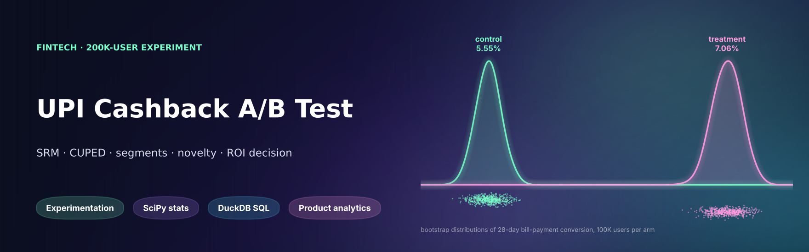
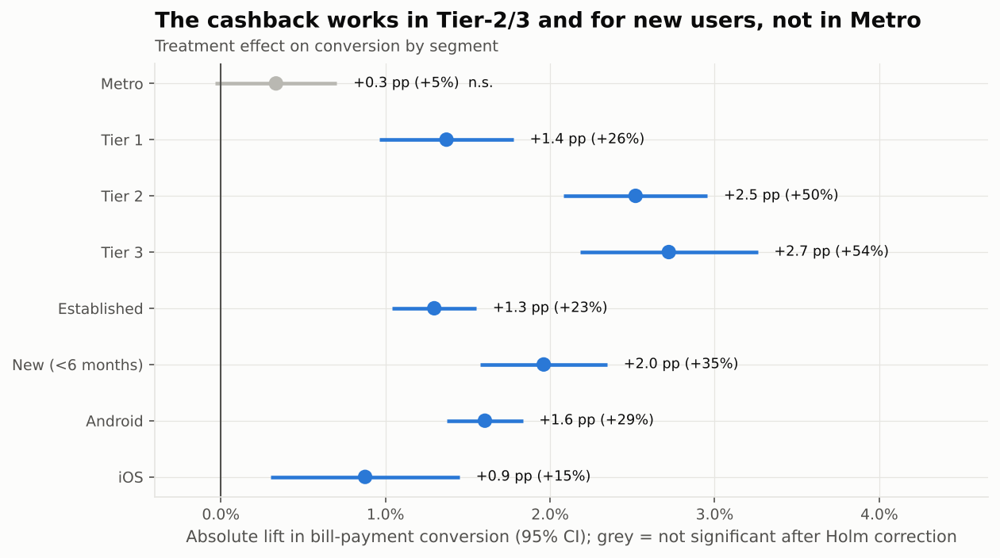
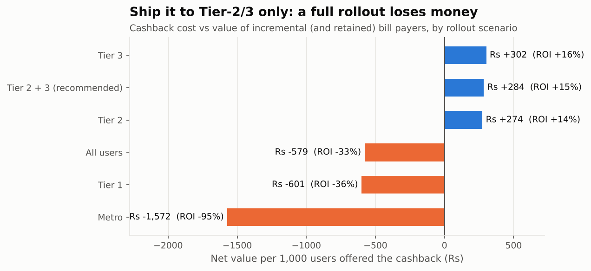
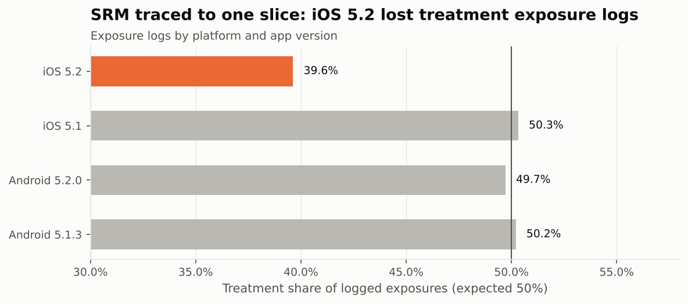
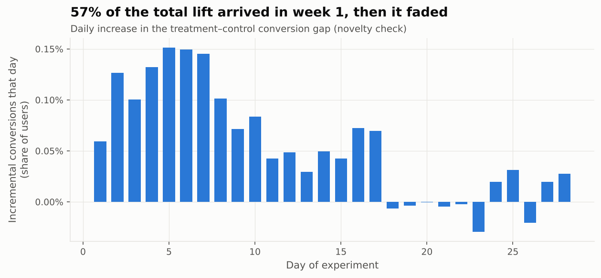

<p align="center"></p>

<p align="center">
  
  
  
  
  
</p>

# Experiment Readout: ₹25 Cashback on the First UPI Bill Payment

**Hypothesis:** a ₹25 cashback on the first in-app bill payment (electricity, mobile, broadband…) converts UPI-only users into
bill payers, and the habit sticks after the cashback ends.

**Design:** 200,000 eligible users, user-level 50/50 randomisation, 28 days (3–30 Nov 2025), then a 28-day post-period with no cashback.
Metrics are built in SQL ([`sql/user_metrics.sql`](sql/user_metrics.sql)). The full readout is one executed notebook:
[`notebooks/experiment_readout.ipynb`](notebooks/experiment_readout.ipynb).

> **Data note:** synthetic experiment logs from [`src/generate_data.py`](src/generate_data.py) (seed 41): assignments, exposure logs,
> bill payments, guardrail events. A logging bug, a novelty effect and heterogeneous effects are planted for the analysis to find.

---

## TL;DR: the decision

> **The cashback works (+1.5 pp conversion, +27%), but a full rollout loses ₹579 per 1,000 users. 79% of the cashback goes to people who would have paid anyway.
> Ship it to Tier-2/3 cities only (ROI +15%). Re-test Metro with a smaller incentive. Fix iOS 5.2 exposure logging before the next test.**

| | Result |
|---|---|
| ✅ **Primary** | Conversion **5.55% → 7.06%** (+1.51 pp, 95% CI +1.29 to +1.72 pp, p < 10⁻⁴⁰). The test was powered for a 0.29 pp MDE. |
| 🚨 **SRM caught** | Assignment was 50/50, but the **exposure logs failed SRM (χ² = 34.8, p = 4×10⁻⁹)**. Slicing traced it to **iOS app v5.2 dropping treatment exposure events** on 6–10 Nov. The primary analysis therefore uses intention-to-treat on the assignment table. Removing the slice restores balance (p = 0.90). |
| 🗺️ **Who it works for** | **Tier 3 +2.7 pp (+54%), Tier 2 +2.5 pp (+50%)**, new users +2.0 pp. **Metro +0.3 pp, not significant** after Holm correction across 8 segments. |
| 📉 **Novelty** | **57% of the total lift arrived in week 1**. The daily incremental effect is near zero by week 3. |
| 🔁 **Habit** | Post-period bill payers rose only **+0.6 pp**. Cashback-induced payers keep paying at a much lower rate than organic ones. |
| 🧪 **CUPED** | Using pre-period UPI activity as covariate, **variance on the P2P guardrail fell 78%**, halving the CI, so **cannibalisation of P2P is ruled out**. On the sparse conversion metric, CUPED barely helps (<1%), which is a known limitation worth stating. |
| 🛡️ **Guardrails** | Uninstalls flat. **Support tickets +7.5% (p = 0.006)** and refunds up from a tiny base. Worth monitoring, not blocking. |
| 💰 **ROI** | Cost per *incremental* payer is **₹117 overall, ₹74 in Tier-2/3 and ₹495 in Metro**. A full rollout would only break even if a retained bill payer were worth more than about ₹270 a year (sensitivity table in the notebook). |

<p align="center">
  
  
</p>
<p align="center">
  
  
</p>

---

## What's in the readout

| Step | Method | Code |
|---|---|---|
| Power / MDE | Two-proportion normal approximation, sample size per arm | `mde_for_power()`, `sample_size_per_arm()` |
| **SRM** | χ² goodness-of-fit on assignment and on exposure logs, then slicing by platform × app version | `srm_test()` |
| Balance | Standardised mean differences of pre-period covariates (all \|SMD\| < 0.1) | `balance_table()` |
| Primary effect | Two-proportion z-test with an unpooled CI | `proportion_test()` |
| Heavy-tailed GMV | Welch t-test plus a **percentile bootstrap** CI | `welch_test()`, `bootstrap_diff_ci()` |
| **CUPED** | θ = cov(y, x) / var(x) on pooled data; variance reduction and CI-width comparison | `cuped()` |
| Segments | Per-segment effects with **Holm–Bonferroni** step-down correction | `segment_effects()`, `holm()` |
| Novelty | Cumulative conversion by day; daily incremental lift | `daily_effect()` |
| Guardrails | Uninstalls, tickets, refunds, P2P transfers | Welch tests |
| **Decision** | Cost per incremental payer, subsidy leakage, retained-payer value, ROI by rollout scenario, sensitivity to assumptions | `roi()` → [`reports/rollout_roi.csv`](reports/rollout_roi.csv) |

## Run it

```bash
pip install -r requirements.txt
python src/generate_data.py
cd notebooks && jupyter nbconvert --to notebook --execute --inplace experiment_readout.ipynb
pytest -q    # SRM sensitivity, z-test maths, power/sample-size consistency, Holm, CUPED unbiasedness, bootstrap, end-to-end
```

## Structure

```
├── notebooks/experiment_readout.ipynb   the readout, executed
├── sql/user_metrics.sql                 per-user metrics from raw event logs
├── src/
│   ├── generate_data.py                 synthetic experiment logs
│   ├── experiment.py                    statistics + ROI (tested)
│   └── charts.py
├── reports/rollout_roi.csv
├── images/ · assets/
└── tests/
```

---

**Author:** Husein Ghadiali · Data Analyst · A/B testing and product analytics · [LinkedIn](https://linkedin.com/in/husein-ghadiali)
